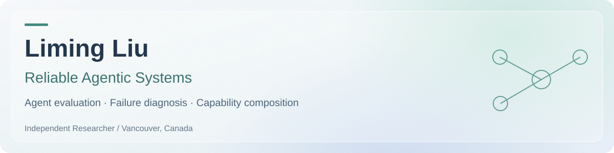

  <a href="CV.pdf"><strong>CV</strong></a> &nbsp;·&nbsp;
  <a href="https://www.linkedin.com/in/liming17/">LinkedIn</a> &nbsp;·&nbsp;

Hi 👋 I'm **Liming Liu**, an independent researcher and software engineer based in Vancouver, Canada. I study how agents can use and compose capabilities reliably, and how evaluation can reveal where their behavior breaks down.

My interests span **reliable autonomous agents, agent safety evaluation, capability learning and composition, and failure diagnosis**. My current projects examine software and enterprise-workflow agents through controlled experiments, trajectory inspection, and state-based evaluation.

## Research projects

### [Where Does Software-Agent Delegation Fail?](https://github.com/liming17/SWE-agent-delegation-research)

*Delegation reliability · Experimental controls · Evaluation validity*

**Question:** when a Planner hands a task to a Developer, what can outcome differences tell us about reliability—and does restoring the original requirement help beyond simply trying again?

- Designed a paired study on **30 SWE-Gate tasks**, with **90 Planner runs and 270 Developer runs**, followed by a separate **270-run prospective retry-control study**.
- Audited trajectories and constraint evaluators, addressed network access as a potential confound, and separated retrospective rescoring from new model execution.
- In the follow-up, source attachment and handoff-only retry each achieved **66/90 joint successes**: a **0.0 percentage-point difference**, with a **95% task-bootstrap interval of −7.8 to +8.9 points**. This established neither an average advantage nor equivalence.

**Research lesson:** a later success does not identify the cause of recovery. Controls and measurement audits matter as much as the initial observation.

[Explore the study, methods and reproducible results →](https://github.com/liming17/SWE-agent-delegation-research)

### [Verified Procedural Skill Composition for Small Language-Model Agents](https://github.com/liming17/IssueOps-Jira-WF-agent-research)

*Capability learning · Workflow simulation · Interface generalization*

**Question:** can a small language-model agent compose workflow decisions it has learned individually into successful, unseen workflows?

- Built a **deterministic, offline Jira–GitHub workflow simulator** with state-based checks for task outcomes and operational constraints.
- Fine-tuned **SmolLM2-360M Base and Instruct** models across three seeds each; all six met the project's atomic-skill proficiency criteria at epoch 4.
- Three qualified Base-model checkpoints completed none of **16 shared unseen composition scenarios each**, despite producing **510/510 structurally valid actions**. Controlled comparisons identified sensitivity to the displayed and permitted tool interface, motivating a shared-interface proficiency requirement for follow-up evaluation.

**Research lesson:** valid action structure and success on isolated skills do not establish workflow competence. Interface changes must be controlled before attributing failure to composition.

[Explore the simulator, experiments and research process →](https://github.com/liming17/IssueOps-Jira-WF-agent-research)

Both are independent research projects. The linked repositories document their methods, evidence boundaries and AI assistance; they are not presented here as peer-reviewed publications.

## Background

| Experience | Focus |
|---|---|
| **SAP · Full Stack Developer** · 2022–2026 | Enterprise software, AI retrieval and workflow-assistance prototypes, performance, and production reliability. Previously an SAP iXp intern, 2020–2021. |
| **Centre for Heart Lung Innovation · Software Engineer Intern** · 2019 | Research software and data workflows in a computational genomics team. |
| **University of British Columbia · MEng** · 2017–2020 | Electrical and Computer Engineering. |
| **Nanjing University of Aeronautics and Astronautics · BEng** · 2013–2017 | Information Engineering; exchange at KAIST in 2015. |

My engineering background motivates questions about agents operating across tools, interfaces and changing workflow states. Through research, I am learning to turn those questions into testable comparisons and conclusions that reflect the limits of the evidence.

## Connect

I'm interested in PhD opportunities and research conversations around **reliable autonomous agents and agent evaluation**.

[CV](CV.pdf) · [LinkedIn](https://www.linkedin.com/in/liming17/) · [liming.ubc.17@gmail.com](mailto:liming.ubc.17@gmail.com)
